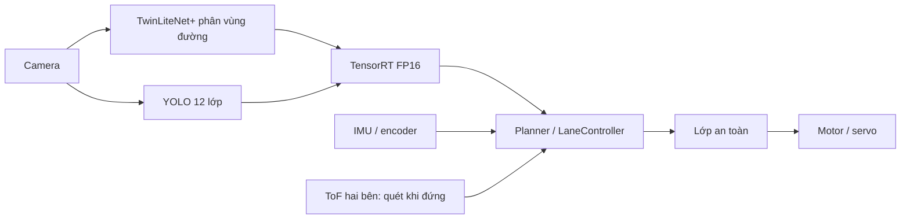

# UIT_Car_Racing_2026

Mã nguồn xe tự hành của đội Hội Đồng Quảng Trị tại vòng chung kết UIT Car Racing 2026, sử dụng xe Jetson Nano do Ban tổ chức (BTC) cung cấp.
Mục tiêu là nhận biết mặt đường, biển báo, đèn giao thông và vật cản để quyết định hành vi và điều khiển xe trên sa bàn.

**Kết quả:** Đội vô địch UIT Car Racing 2026 (vòng chung kết 14/11/2026).

Dataset do nhóm tự thu thập và tự gắn nhãn trên sa bàn thi; tải ở [Release v1.0-final](https://github.com/lmq167/UIT_Car_Racing_2026/releases/tag/v1.0-final), chi tiết ở [docs/datasets.md](docs/datasets.md).

## Thành viên

| Họ tên | Email | Vai trò |
|---|---|---|
| Lê Minh Quân | stkirito74@gmail.com | Thu thập và xử lí dữ liệu, gán nhãn, huấn luyện mô hình, thiết kế giải thuật điều khiển |
| Nguyễn Ngọc Anh Tuấn | — | Gán nhãn, hỗ trợ huấn luyện mô hình, hỗ trợ phần cứng, chỉnh sửa mã nhúng do BTC cung cấp, thiết kế giải thuật điều khiển |
| Nguyễn Văn Chí | nggvanchi@gmail.com | Hỗ trợ gán nhãn, hỗ trợ thiết kế giải thuật điều khiển |

Toàn bộ lịch sử commit nằm dưới một tài khoản vì repo được duy trì từ một máy; phần đóng góp của từng thành viên theo bảng trên, không theo thống kê commit.

## Kiến trúc



Planner là máy trạng thái quyết định hành vi; LaneController tính lệnh bám đường từ mặt nạ phân vùng.
Lớp an toàn kiểm tra tuổi dữ liệu và lệnh, giới hạn tốc độ, giám sát vòng điều khiển bằng watchdog (bộ giám sát hoạt động).
Xem [kiến trúc](docs/kien_truc.md) và [bộ dữ liệu](docs/datasets.md).

## Cấu trúc

```text
car/                   Mã C++ chạy trên xe, cấu hình, công cụ và kiểm thử
  include/             Khai báo các module
  src/                 Nhận thức, điều khiển, phần cứng, cảm biến, ứng dụng
  tools/               Chạy tự hành, thu ảnh, phát lại và kiểm mô hình
  tests/               Kiểm thử phần cứng: camera, IMU, OLED và driver motor UART
training/notebooks/    Notebook huấn luyện và xuất mô hình
training/tools/        Công cụ chuẩn bị dữ liệu, xuất và đối chiếu mô hình
models/                ONNX và siêu dữ liệu đi kèm
docs/                  Kiến trúc, dữ liệu, slide và bản đồ sa bàn
```

`car/config.yaml` chứa cấu hình thiết bị; `car/control.yaml` chứa tham số điều khiển.

## Mô hình

Thư mục `models/` chứa hai ONNX (định dạng trao đổi mạng học sâu) và hai JSON mô tả đầu vào/đầu ra:

| Tệp | Công dụng |
|---|---|
| `twinlitenetplus_192x320.onnx` | TwinLiteNet+ phân vùng nền và mặt đường |
| `twinlitenetplus_192x320_road_info.json` | Chuẩn hóa ImageNet, RGB, thu toàn ảnh về đầu vào |
| `yolo.onnx` | YOLOv5nu D6 phát hiện 12 lớp |
| `yolo_info.json` | Danh sách lớp, chuẩn hóa, thêm đệm giữ tỉ lệ và hậu xử lý |

Ảnh nguồn theo siêu dữ liệu là 1280 × 720; cả hai mạng nhận đầu vào cao × rộng 192 × 320.
ONNX giữ số thực FP32; engine (bản thực thi tối ưu) TensorRT dùng FP16 và phải tạo trên Jetson đích.
Không dùng chung cách chuẩn hóa của hai mạng. Không coi mã lớp trong dataset là mã lớp của model; phải ánh xạ theo tên.

## Kết quả huấn luyện

| Biến thể | Đầu vào (cao × rộng) | GFLOPs | mAP50 val | mAP50-95 val | Suy luận GPU trên xe |
|---|---|---|---|---|---|
| D8 | 288 × 512 | 2,33 | 0,907 | 0,682 | — |
| D2 | 256 × 416 | 2,133 | 0,894 | 0,654 | — |
| D7 | 256 × 416 | 1,869 | 0,869 | 0,629 | — |
| D6 | 192 × 320 | 1,078 | 0,827 | 0,587 | 9,148 ms (trung bình); 11,23 ms (p99) |

`—`: không đo; D6 có lượng tính toán thấp nhất nên được triển khai trực tiếp, các biến thể khác không dựng engine trên xe.

D6 là biến thể dùng khi thi vì nhẹ nhất về lượng tính toán, với đầu vào 192 × 320 và xấp xỉ 1,08 GFLOPs. Đây là đánh đổi tốc độ/độ chính xác: mAP50 của D6 thấp hơn D2 và D8; thời gian GPU chưa gồm tiền/hậu xử lý và không phải FPS toàn hệ thống. Định nghĩa chỉ số, điều kiện đánh giá và nguồn từng số nằm trong [kết quả chi tiết](docs/results/README.md).

## Build (biên dịch)

Môi trường đích: Jetson Nano, JetPack 4.6, Ubuntu 18.04, CMake 3.10, GCC 7, C++17, OpenCV 4.1.1, TensorRT 8.2.
Phần TensorRT và phần cứng chỉ build được trên xe.

Trên xe (trong thư mục `car/`; một đích mỗi lệnh, `-j1` vì Jetson Nano ít RAM):

```bash
mkdir build && cd build && cmake .. && cmake --build . --target ucr_auto -- -j1
```

Trên máy phát triển (MSYS2 UCRT64 có `g++`, `pkg-config`, OpenCV 4) có thể biên dịch riêng thư viện điều khiển, không cần TensorRT:

```bash
for f in car/src/control/*.cpp; do
  g++ -std=c++17 -O2 -Wall -Wextra -Icar/include $(pkg-config --cflags opencv4) -c "$f" -o "/tmp/$(basename "${f%.cpp}").o"
done
```

Lệnh biên dịch thư viện điều khiển trên chạy được với 0 lỗi, 0 cảnh báo. Kiểm thử phần cứng chưa chạy được trên Windows; cần Linux/Jetson.

## Chạy ở mức khái quát

Chuẩn bị mô hình cùng JSON tương ứng, tạo engine trên Jetson và đối chiếu tiền/hậu xử lý trước khi dùng.
Kiểm cấu hình thiết bị, chiều motor, tâm lái và các giới hạn; sau đó vận hành chương trình tự hành tại màn hình xe, có người giám sát và phương án dừng.
Chương trình lấy ảnh mới nhất, suy luận, cập nhật Planner rồi đưa lệnh qua lớp an toàn tới motor/servo; dữ liệu mỗi lượt hỗ trợ phân tích và phát lại.

## Giới hạn đã biết

- Bản công khai quyết định hướng rẽ theo lớp biển do YOLO nhận; không gồm cơ chế chuỗi biển cố định của bản dùng khi thi (mã trong repo không phải nguyên bản đã chạy thi).
- Đây là mã phục vụ sa bàn cuộc thi, chưa chứng minh khả năng vận hành ngoài môi trường đó.
- mAP YOLO đã đối chiếu với CSV kết quả; IoU của TwinLiteNet+ chưa có, chờ huấn luyện lại bằng notebook; FPS toàn hệ thống chưa đo (xem [docs/results/](docs/results/README.md)).
- Slide không cung cấp bằng chứng hoàn tất toàn bộ thao tác đỗ; lượt minh họa dừng bằng Space khi còn lùi.
- ToF nằm hai bên xe; `ucr_auto` đỗ ô cố định, không khởi tạo ToF và không có phanh ToF trước/sau.
- Bộ kiểm thử chỉ giữ phần cứng: một ca CTest driver motor UART qua cổng giả; camera, IMU BNO055 và OLED là chương trình kiểm tra trực tiếp trên xe. Chưa chạy được trên Windows; cần Linux/Jetson để kiểm chứng.
- Công cụ U-Net nằm trong `training/tools/`; mô hình đường dùng TwinLiteNet+ theo JSON đi kèm.
- `car/tools/auto_drive/main.cpp` có IP `192.168.1.100`: chỉ dùng trong mạng LAN tại sân thi, để gửi telemetry tới dashboard phục vụ ban giám khảo chấm thi.

## Nguồn và ghi công

`car/` dựa trên mã mẫu repo [thisinh](https://github.com/LTan17/thisinh) của BTC UIT Car Racing 2026. Phần mã đó thuộc bản quyền BTC; repo thisinh không kèm giấy phép. Nhóm sẽ gỡ phần mã đó nếu BTC yêu cầu.

Các file có nguồn BTC (giữ nguyên hoặc sửa ít):

| Nhóm | File |
|---|---|
| Ứng dụng | `car/include/app/DeviceInitialization.h`, `car/include/app/UI.h`, `car/src/app/UI.cpp` |
| Ghi nhật ký | `car/include/common/Logger.h`, `car/src/common/Logger.cpp` |
| Phần cứng | `car/include/hardware/` và `car/src/hardware/`: `Camera`, `Motor`, `Servo`, `SH1106` (OLED), `SH1106Fonts.h` |
| Cảm biến | `car/include/sensor/BNO055.h`, `TOF.h`; `car/src/sensor/BNO055.cpp`, `TOF.cpp` |
| ToF | `car/src/sensor/tof/` (`LinuxHardware`, `SensorReader`, `SensorSetup`, `StPlatformL0/L1`, `StTransport`, `config.h`) |
| Thư viện ST | `car/src/sensor/tof/vendor/STM_VL53L0X/`, `car/src/sensor/tof/vendor/STM_VL53L1X/` |
| Test phần cứng | `car/tests/hardware/test_bno055.cpp`, `test_camera.cpp`, `test_oled.cpp` (BTC); `CameraGuides.h` và `car/tests/acceptance/acc_motor_uart.cpp`, `acc_common.h` do nhóm bổ sung |

Thư viện VL53L0X/VL53L1X thuộc STMicroelectronics; header bản quyền ST được giữ nguyên trong từng file. Hai chú thích mã theo dõi lỗi nội bộ của ST nằm sẵn trong file gốc `vl53l1_api.c`, không sửa.
Nhận thức, điều khiển, lớp an toàn, công cụ, notebook và mô hình do nhóm viết và huấn luyện.
Slide thuyết trình (`docs/deck.pdf`) và bản đồ sa bàn (`docs/track_map.png`) nằm trong `docs/`; bản đồ là tài liệu tham khảo của đội, không thay thế quy chế BTC.

## Giấy phép

Repo chưa cấp giấy phép: mọi quyền thuộc nhóm tác giả (trừ phần mã BTC và ST nêu trên).
Có thể xem và fork trên GitHub, nhưng không dùng lại mã hoặc dữ liệu khi chưa được nhóm đồng ý.

## English summary

Autonomous driving software of the team that won the UIT Car Racing 2026 final (14/11/2026), running on an organizer-provided Jetson Nano car.
TwinLiteNet+ road segmentation and a twelve-class YOLO detector feed a state-machine planner and lane controller, followed by a safety layer for motor and steering commands.
The repository includes car software, training notebooks, data tools and ONNX models; datasets (self-collected and self-labeled on the competition track) are attached to the v1.0-final release.
Hardware drivers in `car/` come from the organizers' sample code (no license given) and ST's VL53L0X/VL53L1X libraries; they will be removed on request.
No license is granted: all rights reserved by the authors. You may view and fork on GitHub, but do not reuse the code or data without the team's permission.
