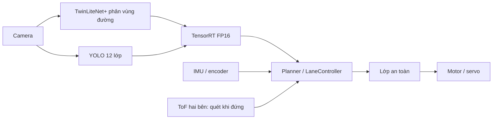

# UIT Car Racing 2026 – đội Hội Đồng Quảng Trị

Mã nguồn xe tự hành của đội Hội Đồng Quảng Trị tại vòng chung kết UIT Car Racing 2026, sử dụng xe Jetson Nano do Ban tổ chức (BTC) cung cấp.
Mục tiêu là nhận biết mặt đường, biển báo, đèn giao thông và vật cản để quyết định hành vi và điều khiển xe trên sa bàn.

| Thông tin | Nội dung |
|---|---|
| Tên và địa chỉ repo | TODO |
| Kết quả thi | TODO |
| Video | TODO |
| Thành viên và vai trò | TODO |
| Giấy phép mã nguồn và mô hình | TODO |
| Quyền công khai dataset (bộ dữ liệu) | TODO |

## Kiến trúc



Planner là máy trạng thái quyết định hành vi; LaneController tính lệnh bám đường từ mặt nạ phân vùng.
Lớp an toàn kiểm tra tuổi dữ liệu và lệnh, giới hạn tốc độ, giám sát vòng điều khiển bằng watchdog (bộ giám sát hoạt động).
Xem [kiến trúc](docs/kien_truc.md) và [bộ dữ liệu](docs/datasets.md).

## Cấu trúc

```text
car/                   Mã C++ chạy trên xe, cấu hình, công cụ và kiểm thử
  include/             Khai báo các module
  src/                 Nhận thức, điều khiển, phần cứng, cảm biến, ứng dụng
  tools/               Chạy tự hành, thu ảnh, phát lại và kiểm mô hình
  tests/               Kiểm thử đơn vị và chấp nhận
training/notebooks/    Notebook huấn luyện và xuất mô hình
training/tools/        Công cụ chuẩn bị dữ liệu, xuất và đối chiếu mô hình
models/                ONNX và siêu dữ liệu đi kèm
docs/                  Kiến trúc, dữ liệu, slide và bản đồ sa bàn
```

`car/config.yaml` chứa cấu hình thiết bị; `car/control.yaml` chứa tham số điều khiển.

## Mô hình

Thư mục `models/` chứa hai ONNX (định dạng trao đổi mạng học sâu) và hai JSON mô tả đầu vào/đầu ra:

| Tệp | Công dụng |
|---|---|
| `twinlitenetplus_192x320.onnx` | TwinLiteNet+ phân vùng nền và mặt đường |
| `twinlitenetplus_192x320_road_info.json` | Chuẩn hóa ImageNet, RGB, thu toàn ảnh về đầu vào |
| `yolo.onnx` | YOLOv5nu D6 phát hiện 12 lớp |
| `yolo_info.json` | Danh sách lớp, chuẩn hóa, thêm đệm giữ tỉ lệ và hậu xử lý |

Ảnh nguồn theo siêu dữ liệu là 1280 × 720; cả hai mạng nhận đầu vào cao × rộng 192 × 320.
ONNX giữ số thực FP32; engine (bản thực thi tối ưu) TensorRT dùng FP16 và phải tạo trên Jetson đích.
Không dùng chung cách chuẩn hóa của hai mạng. Không coi mã lớp trong dataset là mã lớp của model; phải ánh xạ theo tên.

## Build (biên dịch)

Môi trường đích: Jetson Nano, JetPack 4.6, Ubuntu 18.04, CMake 3.10, GCC 7, C++17, OpenCV 4.1.1, TensorRT 8.2.
Phần TensorRT và phần cứng chỉ build được trên xe.

Trên xe (trong thư mục `car/`; một đích mỗi lệnh, `-j1` vì Jetson Nano ít RAM):

```bash
mkdir build && cd build && cmake .. && cmake --build . --target ucr_auto -- -j1
```

Trên máy phát triển (MSYS2 UCRT64 có `g++`, `pkg-config`, OpenCV 4) có thể biên dịch riêng thư viện điều khiển, không cần TensorRT:

```bash
for f in car/src/control/*.cpp; do
  g++ -std=c++17 -O2 -Wall -Wextra -Icar/include $(pkg-config --cflags opencv4) -c "$f" -o "/tmp/$(basename "${f%.cpp}").o"
done
```

Khi chuẩn bị bản công khai, lệnh trên chạy được với 0 lỗi, 0 cảnh báo; bộ test chưa chạy lại sau thi.

## Chạy ở mức khái quát

Chuẩn bị mô hình cùng JSON tương ứng, tạo engine trên Jetson và đối chiếu tiền/hậu xử lý trước khi dùng.
Kiểm cấu hình thiết bị, chiều motor, tâm lái và các giới hạn; sau đó vận hành chương trình tự hành tại màn hình xe, có người giám sát và phương án dừng.
Chương trình lấy ảnh mới nhất, suy luận, cập nhật Planner rồi đưa lệnh qua lớp an toàn tới motor/servo; dữ liệu mỗi lượt hỗ trợ phân tích và phát lại.

## Giới hạn đã biết

- Đây là mã phục vụ sa bàn cuộc thi, chưa chứng minh khả năng vận hành ngoài môi trường đó.
- Chưa có nguồn số liệu mAP/IoU của hai mô hình hoặc FPS toàn hệ thống để công bố.
- Tài liệu slide chưa xác nhận một lượt hoàn tất từ quét ToF đến đỗ xong; một lượt được dẫn dừng bằng Space khi còn pha lùi.
- ToF nằm hai bên xe, dùng quét ô đỗ khi đứng; không có phanh ToF phía trước/sau xe trong `ucr_auto`.
- Bộ kiểm thử được giữ lại từ quá trình phát triển; phiên chuẩn bị bản công khai chưa xác nhận toàn bộ test sau thi.
- Một số tài liệu huấn luyện cũ mô tả U-Net; mô hình đường cuối dùng TwinLiteNet+ theo JSON đi kèm.
- Dữ liệu phân vùng chưa có zip phát hành; giấy phép và quyền công khai dữ liệu còn TODO.

## Nguồn

Hệ thống tham khảo code mẫu BTC tại [LTan17/thisinh](https://github.com/LTan17/thisinh).
Các driver phần cứng và cảm biến trong `car/` (camera, motor, servo, OLED, IMU BNO055, ToF và thư viện VL53L1X của ST) lấy từ code mẫu BTC, gần như giữ nguyên; nhận thức, điều khiển, an toàn và công cụ do đội viết.
Slide thuyết trình (`docs/deck.pdf`) và bản đồ sa bàn (`docs/track_map.png`) nằm trong `docs/`; bản đồ là tài liệu tham khảo của đội, không thay thế quy chế BTC.

## English summary

Autonomous driving software for the UIT Car Racing 2026 final, running on an organizer-provided Jetson Nano car.
TwinLiteNet+ road segmentation and a twelve-class YOLO detector feed a state-machine planner and lane controller, followed by a safety layer for motor and steering commands.
The repository includes car software, training notebooks and data tools. Competition results, video, contributors, license and dataset publication rights: TODO.
